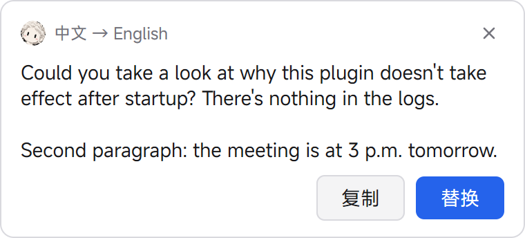
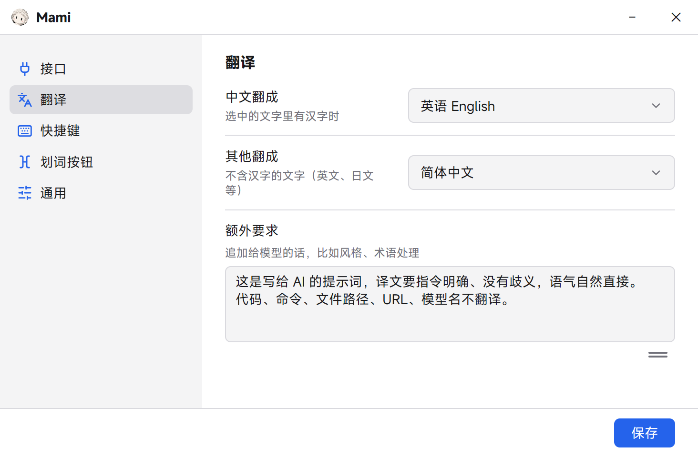
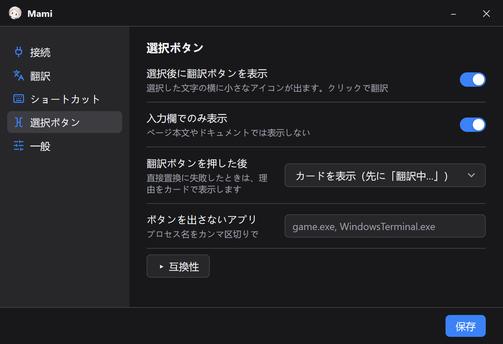

<div align="center">


# Mami

**Select text in any input box, click a tiny button, get the translation.**<br>
Or press <kbd>Alt</kbd>+<kbd>T</kbd> and it is translated and replaced right where you type.

[](https://github.com/margbug01/mami/releases/latest)
[](LICENSE)


[Website](https://margbug01.github.io/mami/) · [Download](https://github.com/margbug01/mami/releases/latest) · [中文说明](README_zh.md)

<picture>
  <source media="(prefers-color-scheme: dark)" srcset="docs/card.png">
  
</picture>

</div>

A lightweight Windows tray app written in Go with [MyGo](https://github.com/egoist/mygo). It talks to any OpenAI-compatible API, so you bring your own model and key.

## Why

I write a lot of prompts in Chinese and send them in English. Copy, open a translator, paste, copy, paste back — it gets old fast. Mami lives in the tray and does it where you are already typing: Alma, ChatGPT, a browser textarea, WeChat, Notepad.

## Features

- **Select → button → card.** A small pixel-art 「文A」 button appears at the end of your selection. Click it for a card with **Copy** and **Replace**.
- **`Alt+T` replaces in place.** Nothing selected? It selects the whole input box first, translates, and pastes the result back.
- **Only in input boxes.** UI Automation tells an editable field from page text, so reading a web page doesn't scatter buttons around. Double-clicking an empty box doesn't trigger it either.
- **Three click modes.** Show a loading card, show the card only when the result arrives, or replace directly. In the quiet modes the button turns into a spinner; errors always show a card.
- **Never steals focus.** Floating windows are non-activating, so your selection stays put. Your clipboard is saved and restored afterwards.
- **Optional live display.** Turn on *Show while translating* and the card fills in while the model is still writing. Either way, if the connection drops halfway you keep the part that arrived (marked as incomplete).
- **Translation history (opt-in).** Saves the original, the exact prompt sent to the model, the translation, timings and what you did with it (copy / replace / closed unused) to daily JSONL files. Hand them to an AI to find prompts the model *executed* instead of translating, ignored instructions, or inconsistent terms. The **History** page in Settings shows a 6-month heatmap, a time-of-day chart, busiest hours, top apps, how often a translation was actually used, and average speed.
- **Safe in terminals.** In Windows Terminal it sends *no* keystrokes (a stray `Ctrl+C` would kill your running program) and reads the selection through UI Automation. The card shows Copy only.
- **Model-aware prompts.** Dedicated formats for translation models such as Tencent **Hy-MT2** and bilibili **Index-Translate**, and a generic system prompt for everything else (DeepSeek, GPT, Qwen…).
- **20 target languages**, extra instructions and glossary, proxy, per-app exclusions, start at login.
- **Light and dark themes**, following Windows or set by hand. The interface is set in [MiSans](https://hyperos.mi.com/font) (a subset is built in).
- **9 interface languages**: 简体中文, 繁體中文, English, 日本語, 한국어, Español, Français, Deutsch, Русский.

## Screenshots

<table>
  <tr>
    <td align="center">
      <picture>
        <source media="(prefers-color-scheme: dark)" srcset="docs/settings.png">
        
      </picture>
      <br><sub>Settings follow your theme. The extra-instructions box grows with its content, or drag the handle to size it yourself.</sub>
    </td>
  </tr>
  <tr>
    <td align="center">
      
      <br><sub>The same window in Japanese.</sub>
    </td>
  </tr>
</table>

## Install

Download `Mami Setup x.y.z amd64.exe` (installer) or `Mami.exe` (portable) from [Releases](https://github.com/margbug01/mami/releases/latest). Windows 10/11, x64.

On first launch the settings window opens on the API page. Pick a **Provider** (bilibili free, Tencent TokenHub, OpenRouter, DeepSeek, or Custom) and it fills in the endpoint and model; press **Test connection** to check it before saving. Until you change it, Mami uses bilibili's **free** Index-Translate-35B endpoint (no key needed), which gets overloaded at peak hours and may return 504.

## Recommended backends

| Provider | Base URL | Model | Notes |
|---|---|---|---|
| Tencent TokenHub | `https://tokenhub.tencentmaas.com/v1` | `hy-mt2-pro` | Paid, stable, about 1 s. What I use daily. Also `hy-mt2-plus`, `hy-mt2-lite` |
| OpenRouter | `https://openrouter.ai/api/v1` | `tencent/hy-mt2-30b-a3b` | Same model family, pay as you go |
| bilibili (free) | `https://index-translate.bilibili.com/v1` | `Index-Translate-35B-A3B` | No key; flaky at night |
| Anything OpenAI-compatible | … | … | DeepSeek, Qwen, local vLLM / Ollama |

### Tip: translating prompts

Translation models will happily *execute* a multi-line prompt instead of translating it. Put something like this in **Extra instructions** (额外要求):

```
这是写给 AI 的提示词，译文要指令明确、没有歧义，语气自然直接，不要书面腔
保留原文的结构：换行、编号、列表、标题、代码块、变量占位符（如 {name}、<tag>）原样保留
代码、命令、文件路径、URL、模型名、产品名不翻译
术语对照：划词→text selection、提示词→prompt
```

## Usage

| Action | What happens |
|---|---|
| Select text in an input box | The button appears next to the selection |
| Click the button | Card, quiet card, or direct replace (configurable) |
| `Alt+T` | Translate and replace in place |
| `Alt+Shift+T` | Translate and show the card only |
| Tray icon → right click | Settings, toggle the button, open log, quit |

Direction is automatic. Text containing Chinese goes to your **Chinese to** language (English by default); everything else goes to **Others to** (Simplified Chinese by default).

Settings has six pages: **API**, **Translation**, **Shortcuts**, **Selection button**, **General** and **History** (interface language, theme, start at login). Language and theme changes preview live and apply when you press Save.

Config lives in `%AppData%\Mami\config.json`, translation history (if turned on) in `%AppData%\Mami\history\YYYY-MM-DD.jsonl`, logs in `%AppData%\Mami\logs\mami.log`. Your API key is stored there encrypted with Windows DPAPI (only your Windows account on this PC can decrypt it; keys saved by older versions are encrypted on the next start) and is only sent to the endpoint you configured.

## Known limitations

- **WeChat 4.x** (Qt) exposes nothing to Windows accessibility, so Mami can't tell its input box from the chat history. With 「认不出输入框的程序也弹」 (*Also show in apps that hide their input boxes*) on, selecting a chat message also shows the button. Turn it off and use `Alt+T` if that bothers you.
- Apps that don't support `Ctrl+C` (games, remote desktop) can't be read. Elevated apps need Mami running elevated too.
- In terminals there is no in-place replace, because pasting doesn't remove the selected text.
- Only tested on Windows 11 at 125% scaling, single monitor.
- The interface translations other than Chinese and English were checked for meaning, consistent terms and Windows wording, but not by native speakers. Corrections are welcome.

## Build

Requires Go 1.27.1+ (`GOTOOLCHAIN=auto` downloads it).

```bash
go test ./...
go tool mygo build      # → build/windows-amd64/Mami.exe + NSIS installer
```

Pushing a `v*` tag runs `.github/workflows/release.yml`: it tests, builds and publishes the installer and portable exe to that release. The tag must match `version` in `mygo.json`, or the build fails.

`Mami.exe -demo` draws the button and a sample card for a quick UI check. The screenshots in `docs/` are rendered off-screen: `MAMI_DOCS=$PWD/docs go test ./internal/app -run TestSnapDocs`.

### How it's put together

`main.go` is a thin entry point. The code lives in `internal/app/` (the files below) and `internal/i18n/` (interface translations).

| File | Role |
|---|---|
| `main.go` / `app.go` | Startup, tray, hotkeys, button and card placement, translate flow |
| `views.go` / `settings.go` | MyGo views: button (pixel-snapped dot matrix), card, settings |
| `internal/i18n/` | Interface translations, one dictionary per language. Write `T("中文")` in code and add the other languages; a test fails if one is missing |
| `hook.go` | Low-level mouse and keyboard hooks on a dedicated OS thread |
| `uia.go` | UI Automation via raw COM vtables: is the focus editable, where is the selection, terminal selection text |
| `worker.go` / `clipboard.go` | Message-only window that owns the clipboard and sends `Ctrl+C` / `Ctrl+V` |
| `translate.go` / `config.go` | Streaming API requests, per-model prompt formats, config |
| `dpapi.go` | Encrypts the API key in the config with Windows DPAPI |
| `history.go` / `historystats.go` / `historypage.go` | Opt-in translation history (daily JSONL, auto-pruned), its statistics and the History page |

MyGo handles the window, tray, global shortcuts, single instance and auto-start. The global hook, cross-process selection, and non-activating floating windows are plain Win32 via `syscall` — no cgo.

## License

[MIT](LICENSE)
