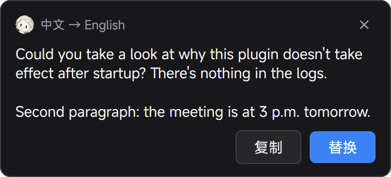
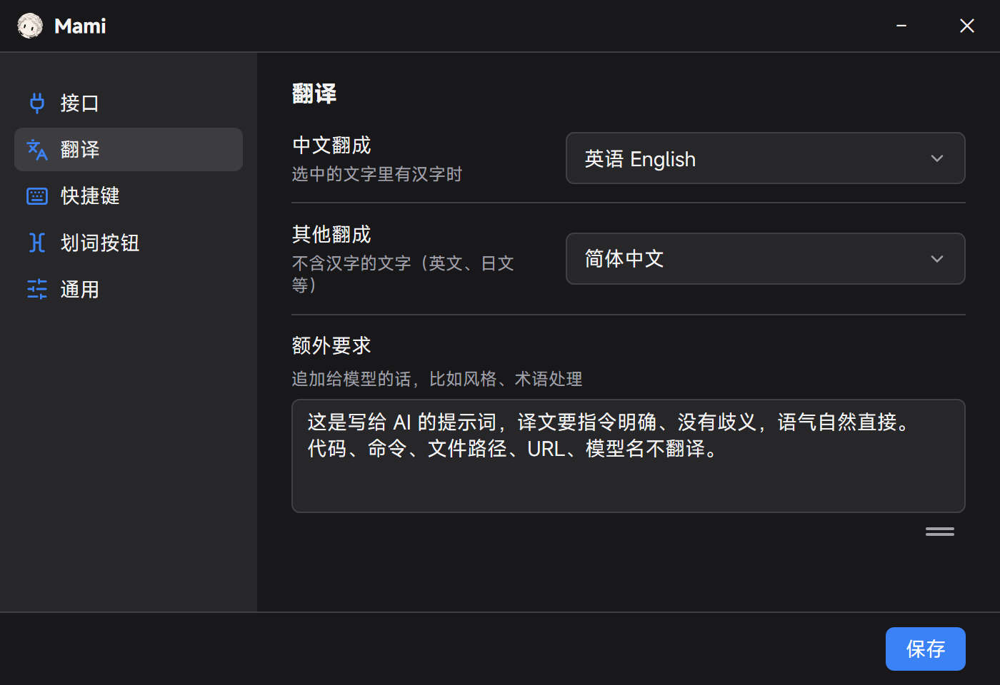

<div align="center">


# Mami · 划词翻译

**Select text in any input box, click a tiny button, get the translation — or press `Alt+T` to translate and replace in place.**

A lightweight Windows tray app written in Go with [MyGo](https://github.com/egoist/mygo). Works with any OpenAI-compatible API.

[中文说明](README_zh.md) · [Download](https://github.com/margbug01/mami/releases/latest)



</div>

## Why

I write a lot of prompts in Chinese and send them in English. Copy → open a translator → paste → copy → paste back gets old fast. Mami lives in the tray and does it where you're typing: Alma, ChatGPT, a browser textarea, WeChat, Notepad.

## Features

- **Select → button → card.** A small pixel-art 「文A」 button appears at the end of your selection. Click it for a card with **Copy** / **Replace**.
- **`Alt+T` replace in place.** Nothing selected? It selects the whole input box first, translates, and pastes the result back.
- **Only in input boxes.** Uses UI Automation to tell an editable field from page body text, so reading a web page doesn't pop buttons everywhere. Double-clicking an empty box doesn't trigger it either.
- **Three click modes.** Show a loading card, show the card only when the result arrives, or replace directly. In the quiet modes the button turns into a spinner, so you always know it's working; errors always show a card.
- **Never steals focus.** Floating windows are `WS_EX_NOACTIVATE`; your selection stays put. Your clipboard is snapshotted and restored afterwards.
- **Terminal-safe.** In Windows Terminal it sends *no* keystrokes (an unwanted `Ctrl+C` would kill your running program) and reads the selection via UIA instead. Card shows Copy only.
- **Model-aware prompts.** Dedicated prompt formats for translation models like Tencent **Hy-MT2** and bilibili **Index-Translate**; a generic system prompt for everything else (DeepSeek, GPT, Qwen…).
- **20 target languages**, extra instructions / glossary, proxy, per-app exclusions, start at login, light/dark theme.

<p align="center"></p>

## Install

Grab `Mami Setup x.y.z amd64.exe` (installer) or `Mami.exe` (portable) from [Releases](https://github.com/margbug01/mami/releases/latest). Windows 10/11, x64.

On first launch the settings window opens. Out of the box it points at bilibili's **free** Index-Translate-35B endpoint (no key needed) so you can try it immediately — note that free endpoint gets overloaded at peak hours and may return 504.

## Recommended backends

| Provider | Base URL | Model | Notes |
|---|---|---|---|
| Tencent TokenHub | `https://tokenhub.tencentmaas.com/v1` | `hy-mt2-pro` | Paid, stable, ~1 s. What I use daily. Also `hy-mt2-plus`, `hy-mt2-lite` |
| OpenRouter | `https://openrouter.ai/api/v1` | `tencent/hy-mt2-30b-a3b` | Same model family, pay as you go |
| bilibili (free) | `https://index-translate.bilibili.com/v1` | `Index-Translate-35B-A3B` | No key; flaky at night |
| Anything OpenAI-compatible | … | … | DeepSeek, Qwen, local vLLM / Ollama |

### Tip for translating prompts

Translation models will happily *execute* a multi-line prompt instead of translating it. Put something like this in **额外要求** (extra instructions):

```
这是写给 AI 的提示词，译文要指令明确、没有歧义，语气自然直接，不要书面腔
保留原文的结构：换行、编号、列表、标题、代码块、变量占位符（如 {name}、<tag>）原样保留
代码、命令、文件路径、URL、模型名、产品名不翻译
术语对照：划词→text selection、提示词→prompt
```

## Usage

| Action | What happens |
|---|---|
| Select text in an input box | Button appears next to the selection |
| Click the button | Card / quiet card / direct replace (configurable) |
| `Alt+T` | Translate and replace in place |
| `Alt+Shift+T` | Translate and show the card only |
| Tray icon → right click | Settings, pause button, open log, quit |

Direction is automatic: text containing Chinese → your "Chinese to" language (English by default); everything else → your "others to" language (Simplified Chinese by default).

Config lives in `%AppData%\Mami\config.json`, logs in `%AppData%\Mami\logs\mami.log`. Your API key stays in that file and is only sent to the endpoint you configured.

## Known limitations

- **WeChat 4.x** (Qt) exposes nothing to Windows accessibility, so Mami can't tell its input box from the chat history. With 「认不出输入框的程序也弹」 on, selecting a chat message also shows the button. Turn it off and use `Alt+T` if that bothers you.
- Apps that don't support `Ctrl+C` (games, remote desktop) can't be read. Elevated apps need Mami running elevated too.
- In terminals there is no in-place replace — pasting doesn't remove the selected text.
- Only tested on Windows 11 at 125% scaling, single monitor.

## Build

Requires Go 1.27.1+ (`GOTOOLCHAIN=auto` downloads it).

```bash
go test ./...
go tool mygo build      # → build/windows-amd64/Mami.exe + NSIS installer
```

`Mami.exe -demo` draws the button and a sample card for a quick UI check.

### How it's put together

| File | Role |
|---|---|
| `main.go` / `app.go` | Startup, tray, hotkeys, button/card placement, translate flow |
| `views.go` / `settings.go` | MyGo views: button (pixel-snapped dot matrix), card, settings |
| `hook.go` | Low-level mouse + keyboard hooks on a dedicated OS thread |
| `uia.go` | UI Automation via raw COM vtables: is the focus editable, where is the selection, terminal selection text |
| `worker.go` / `clipboard.go` | Message-only window that owns the clipboard and sends `Ctrl+C` / `Ctrl+V` |
| `translate.go` / `config.go` | API requests, per-model prompt formats, config |

MyGo handles the window, tray, global shortcuts, single instance and auto-start. The global hook, cross-process selection, and non-activating floating windows are plain Win32 via `syscall` — no cgo.

## License

[MIT](LICENSE)
