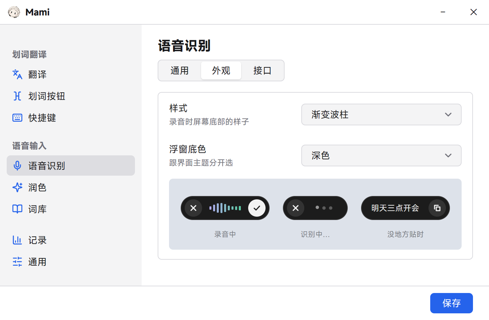
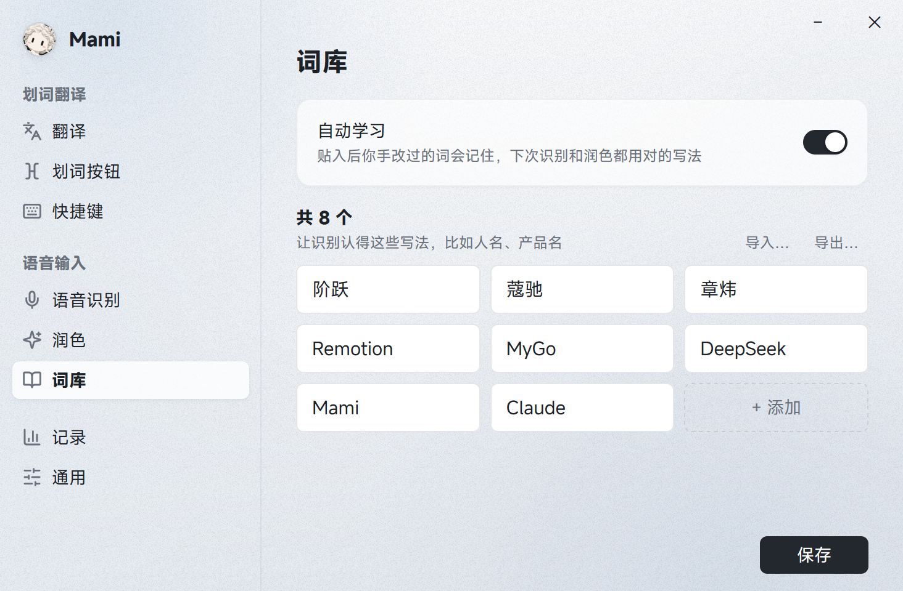

<div align="center">


# Mami

**在哪打字，就在哪说、在哪翻译。**<br>
按一下右 <kbd>Alt</kbd> 开口说，说完自动整理好贴进输入框；选中文字点一下，原地翻译。

[](https://github.com/margbug01/mami/releases/latest)
[](LICENSE)


[主页](https://margbug01.github.io/mami/) · [下载](https://github.com/margbug01/mami/releases/latest) · [English](README.md)

<picture>
  <source media="(prefers-color-scheme: dark)" srcset="docs/voice.png">
  
</picture>

</div>

用 Go 和 [MyGo](https://github.com/egoist/mygo) 写的 Windows 托盘小工具，两件事：**语音输入**和**划词翻译**。识别、润色、翻译都接你自己的接口和 Key，录音和文字只发给你填的那几家。

## 为什么做

我每天要在 Alma、ChatGPT、微信里写很多话，尤其是给 AI 的长提示词。打字慢，说出来又是一堆「嗯」「那个」「不对，是……」；写完中文还常常要翻成英文。Mami 常驻托盘，在你正打字的那个框里直接干活：说完就是整理好的文字，选中就能翻。

## 语音输入

- **按一下说，再按一下贴。** 默认右 <kbd>Alt</kbd>，可以换成任意左右修饰键、F1–F24、CapsLock、组合键，或者遥控器、翻页笔会发的媒体键。<kbd>Esc</kbd> 取消。按住触发键再按别的键算组合键，不会误触发。
- **说完马上出字。** 阶跃接口按停顿分段，边说边把前面的送去识别；千问 3.1 流式接口边录边推，停下来通常只等半秒左右。太短、太小声的录音直接不发。
- **润色五档，按程序自动换。** 关 / 轻 / 标准 / 结构化 / 提示词。在 Cursor、ChatGPT 这类 AI 工具里自动用「提示词」档：要求和限制一条不丢，文件名、命令、英文术语原样保留；在微信、QQ 里用轻润色。所有档位都会去掉口头禅和改口（「三点，不对，四点」只留「四点」），问句不会被当成问题回答，不会偷偷翻译；结构化会在你明确列举时分点。默认用 DeepSeek，任何 OpenAI 兼容接口都行，润色失败就贴原话。
- **词库和自动学习。** 人名、产品名加进词库，识别和润色都会照着写；加词时会自动猜几种常见听错写法。贴进去以后你手改了词（张伟→章炜），Mami 会记下来，同一个词改过两次就生效。只学读音像的改动，换了意思的改动不学；润色要是把「同学张伟」也换成章炜，会被换回来。
- **长文改写样本（可清空）。** 40 字以上的口述，会在本机记下原话、润色稿和你最后改成的样子，为以后学你的说话习惯攒数据，现在只记录不使用。
- **选中再说，就按你说的改。** 先选中一段字再按触发键，说「翻成英文」「写正式点」「缩短一半」「把最后一句删掉」，就原地改好；说的不是要求（比如一句新的话或一个问题），就用你说的话换掉选中的内容。改完胶囊里有 ↺，点一下撤回。改写没成功时原文不动。
- **识别失败可以重试。** 网络出问题时录音留着，胶囊里点 ↻ 再识别一次，说过的话不会白说。
- **没地方贴也不丢。** 光标不在输入框里时，胶囊里显示这句话和复制钮；微信这类认不出输入框的程序照样贴，文字留在剪贴板里。
- **七种胶囊样式。** 渐变波柱、果冻球、磨砂玻璃、复古像素、水银、三岛连桥、分段电平，底色深浅可以跟主题分开选；开始、结束、取消有轻轻的「嘚嘚」提示音。可选「边说边出字」，胶囊里滚动显示最新几个字（默认关）。
- **不想按键盘也行。** `Mami.exe -voice toggle|start|stop|cancel` 会交给已经在跑的 Mami，脚踏板、Stream Deck、AutoHotkey 都能接。

<picture>
  <source media="(prefers-color-scheme: dark)" srcset="docs/words.png">
  
</picture>

## 划词翻译

<picture>
  <source media="(prefers-color-scheme: dark)" srcset="docs/card.png">
  
</picture>

- **选中 → 按钮 → 卡片。** 在输入框里选中文字，选区末尾冒出一个像素风的「文A」小按钮，点它弹出译文卡片，有**复制**和**替换**；<kbd>Enter</kbd> 替换、<kbd>Esc</kbd> 关闭。
- **<kbd>Alt</kbd>+<kbd>T</kbd> 原地替换**，<kbd>Alt</kbd>+<kbd>Shift</kbd>+<kbd>T</kbd> 只弹卡片。没选中文字时先全选整个输入框。
- **只在输入框里弹。** 用 UI Automation 区分输入框和网页正文，看网页时不会到处冒按钮。
- **按模型拼提示词。** 腾讯 Hy-MT2、B 站 Index-Translate 有专用格式，其他模型用通用系统提示词；20 种目标语言，可以写额外要求和术语表；可选边翻边显示。
- **终端里也安全。** Windows Terminal 里一个键都不发，改用 UI Automation 读选区，卡片只给「复制」。

## 两边共用的

- **不抢焦点。** 浮窗都不激活，选区不会丢；每次贴完、翻完都还原你的剪贴板。
- **服务商一点就填好。** 设置里带 logo 的分段条选一家，地址和模型自动填，「获取 Key」直接跳过去；每个接口地址的 Key 各记一份，切走再切回来不用重填。
- **记录页。** 语音：最近半年的热力图、一天各时段分布、次数、字数、比打字省下的时间、润色平均耗时，每条能看到原话和润色后的样子。翻译（默认关）：原文、实际发给模型的提示词、译文、耗时、你拿它做了什么，按天存成 JSONL，方便以后交给 AI 复盘。
- **一键更新、开机自启、按程序排除、代理。** 浅色/深色主题，设置窗口记住大小和位置；界面字体 [MiSans](https://hyperos.mi.com/font)。
- **9 种界面语言**：简体中文、繁體中文、English、日本語、한국어、Español、Français、Deutsch、Русский。

## 安装

到 [Releases](https://github.com/margbug01/mami/releases/latest) 下载 `Mami Setup x.y.z amd64.exe`（安装包）或 `Mami.exe`（绿色版）。Windows 10/11，x64。

第一次启动会打开设置。

- **翻译**：「翻译 → 接口」里选服务商，点「测试连接」。不改的话用的是 B 站**免费**的 Index-Translate（不用 Key，高峰期可能 504）。
- **语音**：「语音识别 → 通用」打开语音输入，在「接口」里选识别服务商填 Key；「润色」页填润色接口的 Key（不填就贴原话）。

## 推荐的接口

| 用途 | 服务商 | Base URL | 模型 | 说明 |
|---|---|---|---|---|
| 语音识别 | 阿里云百炼 | `https://dashscope.aliyuncs.com/compatible-mode/v1` | `qwen-audio-3.1-asr-flash-streaming` | 流式，边说边识别，停下约 0.5 秒出结果；`qwen3-asr-flash` 也能用 |
| 语音识别 | 阶跃星辰 | `https://api.stepfun.com/v1` | `stepaudio-3-asr-max` | 按停顿分段识别，约 1 秒 |
| 润色 | DeepSeek | `https://api.deepseek.com/v1` | `deepseek-flash` | 自动关掉思考，0.5–1 秒；也可以用百炼 `qwen-flash` 或任何 OpenAI 兼容接口 |
| 翻译 | 腾讯 TokenHub | `https://tokenhub.tencentmaas.com/v1` | `hy-mt2-pro` | 收费、稳定、约 1 秒，我自己天天用 |
| 翻译 | OpenRouter | `https://openrouter.ai/api/v1` | `tencent/hy-mt2-30b-a3b` | 同一系列模型，按量付费 |
| 翻译 | B 站（免费） | `https://index-translate.bilibili.com/v1` | `Index-Translate-35B-A3B` | 不用 Key，晚上不太稳 |

### 小技巧：翻译提示词

翻译模型碰到多行的提示词，常常会直接去「执行」而不是翻译。在**额外要求**里写上类似这样的话：

```
这是写给 AI 的提示词，译文要指令明确、没有歧义，语气自然直接，不要书面腔
保留原文的结构：换行、编号、列表、标题、代码块、变量占位符（如 {name}、<tag>）原样保留
代码、命令、文件路径、URL、模型名、产品名不翻译
术语对照：划词→text selection、提示词→prompt
```

## 数据放在哪

都在 `%AppData%\Mami\`：`config.json`（配置，所有 API Key 用 Windows DPAPI 加密，只有这台电脑上你的账户解得开）、`learned.json`（词库）、`samples.jsonl`（长文改写样本，设置里可清空）、`history\`（记录，按天 JSONL）、`logs\mami.log`。录音不落盘，只发给你选的识别接口。

## 已知限制

- **微信 4.x**（Qt 自绘）不暴露输入框信息：划词时分不清输入框和聊天记录；语音照样贴，但学不到你在里面改的词。
- 自动学习靠 UI Automation 读输入框，读不到文字的程序学不了。
- 不支持 `Ctrl+C` / `Ctrl+V` 的地方（游戏、远程桌面）取不到字也贴不进去；管理员权限运行的程序，Mami 也得用管理员权限运行。
- 只在 Windows 11、125% 缩放、单显示器上测过。中英文以外的界面翻译还没有母语者审过，欢迎指正。

## 构建

需要 Go 1.27.1+（`GOTOOLCHAIN=auto` 会自动下载）。

```bash
go test ./...
go tool mygo build      # → build/windows-amd64/Mami.exe + NSIS 安装包
```

推一个 `v*` 标签会跑 `.github/workflows/release.yml`：测试、构建，把安装包和绿色版传到 Release。标签必须和 `mygo.json` 里的 `version` 一致。

- `Mami.exe -demo`：画出划词按钮和一张示例卡片。
- `Mami.exe -demo-voice [-demo-style mercury]`：用假音量把语音胶囊的几种状态放一遍，不开麦克风。
- `docs/` 里的截图是离屏渲染的：`MAMI_DOCS=$PWD/docs go test ./internal/app -run TestSnapDocs`。
- 真连接口的测试默认跳过：`MAMI_ASR_LIVE=1`（阶跃）、`MAMI_QWEN_KEY=sk-…`（千问）。

### 代码结构

根目录的 `main.go` 只是入口，代码在 `internal/app/` 和 `internal/i18n/`（界面翻译，代码里写 `T("中文")`，漏翻测试会失败）。

| 文件 | 作用 |
|---|---|
| `app.go` / `run.go` | 启动、托盘、快捷键、单实例和 `-voice` 命令、划词按钮和卡片 |
| `views.go` / `settings.go` | MyGo 界面：按钮、卡片、设置各页 |
| `hook.go` / `keycapture.go` | 低级鼠标 + 键盘钩子（独立 OS 线程），快捷键录制 |
| `uia.go` | 原生 COM 调 UI Automation：焦点是不是输入框、选区、光标附近的文字 |
| `worker.go` / `clipboard.go` | 消息窗口线程：剪贴板、模拟 `Ctrl+C` / `Ctrl+V` |
| `translate.go` / `config.go` / `dpapi.go` | 翻译请求、配置读写、Key 加密 |
| `voice_windows.go` / `voice_keys.go` / `voice_record_windows.go` | 语音流程、触发键状态机、waveIn 录音、胶囊浮窗 |
| `voice_islands_windows.go` / `voice_sound_windows.go` | 三岛样式、内存合成的提示音 |
| `asr.go` / `asr_stream.go` | 识别：阶跃 SSE、OpenAI 兼容 chat、千问 3.1 WebSocket 流式；按停顿分段 |
| `polish.go` | 润色和防误改（只放行有纠错记录撑腰的同音替换） |
| `learn.go` / `learn_windows.go` / `samples.go` | 词库、自动学习（拼音校验）、长文改写样本 |
| `history*.go` | 记录、统计、热力图和「记录」页 |

窗口、托盘、全局快捷键、单实例、开机自启交给 MyGo；钩子、录音、跨进程读选区、不抢焦点的浮窗是纯 Win32（`syscall`），不用 cgo。

## 许可

[MIT](LICENSE)。厂商 logo 来自 [LobeHub Icons](https://github.com/lobehub/lobe-icons)（MIT）。
